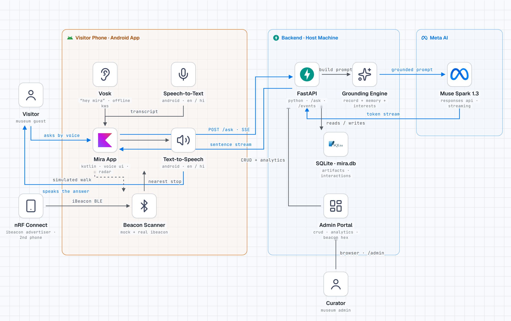

# Mira — Your Voice Guide to the Gallery

**Stand near a painting. Ask out loud. A guide answers — in your language.**

Mira is a voice-first AI museum guide. BLE beacons tell the app which artifact you are standing in front of; Meta Muse — grounded in the curator's own records — greets you, answers your questions, remembers your tour, and speaks back like a human guide. No typing. No reading labels. Built solo for the **Meta AI Global Hackathon (Indie Developer track)**.

`Android 8+` · `English + हिंदी` · `Muse Spark 1.3` · `Simulated + real BLE beacons` · `Voice in, voice out`

## Try it in 2 minutes

- **Download the app:** [Mira v1.0 APK — Google Drive](https://drive.google.com/file/d/1A4yj5GN1hEyEOCzmC36WrrS1CaFun3x3/view?usp=drivesdk) · [GitHub mirror](https://github.com/tejas297/Mira-ai-museum-guide/raw/main/app-release.apk) (Android, 40 MB) — allow "install unknown apps", install, grant the microphone permission.
- **Demo video:** [Demo Video link](https://drive.google.com/file/d/1MIrU6hwJXf9l_l6kVHjClO3AFp4AIRhx/view?usp=drivesdk) also demo video added in demo folder of current repo as mira_demo.mp4
- **Live backend:** [health check](https://mira-ai-museum-guide.fly.dev/health) · **Curator admin:** [/admin](https://mira-ai-museum-guide.fly.dev/admin) (login required — it is shown in the demo video)

**What to try in the app**

1. First launch only: pick a language, tap **Start exploring**, then **Skip** the interests popup (or save some). You land at *Sita Bhoomi Pravesh* — Simulated beacons need no hardware — and Mira greets you out loud.
2. Tap **Ask Mira**, or turn on the **“Hey Mira”** chip above the mic and just speak (first use downloads a small offline voice model, ~40 MB). Interrupt her mid-sentence — she stops and listens.
3. Ask a follow-up. Then tap the **globe** (top right) and ask in **हिंदी**.
4. Switch beacons to **Real** and advertise an iBeacon (nRF Connect, major 1 / minor 12, 15, 18, 19 or 21) from a second phone — the stop flips as you walk.
5. Tap the **chat icon** if you ever want the transcript. You should not need it.

## Architecture



The blue path is the product: **voice in → on-device wake word → transcript → FastAPI → Grounding Engine (curator record + tour memory + interests) → Muse Spark 1.3 → sentence stream → spoken answer.** Full diagram, both themes: [diagrams/](diagrams/).

## The problem

A museum's default language is the **wall label** — small text that assumes you can see it, read its language, and want to stand still reading. Every existing fix trades one problem for another:

- **Human guides** are wonderful — and scarce. They run on schedules, cost a salary per language, vary in quality, and cannot be cloned for a school group of sixty or a single Tuesday visitor.
- **Pre-recorded audio devices** (the rented wand with a number pad) fixed availability, but froze the experience: one fixed script, in a fixed order, at a fixed pace. You cannot ask it anything. It does not know where you are standing — you hunt for numbers. It is the same for a child, an art historian, and a first-time visitor. And the museum must buy, charge, clean, repair, and replace a fleet of hardware that visitors queue to collect and return.

So the visitor who benefits most from guidance — a blind visitor, an elderly visitor, a child, a Hindi speaker in an English gallery — is still the one the system fails. And curators still have no idea what visitors actually wonder about in front of each painting.

| | Wall label | Human guide | Pre-recorded device | **Mira** |
|---|---|---|---|---|
| Speaks to you | No | Yes | Yes, fixed script | Yes, live conversation |
| You can ask questions | No | Yes | **No** | Yes, unlimited follow-ups |
| Knows where you are | No | Yes | No — you type numbers | Yes — BLE finds the artifact |
| Adapts to you (age, interests, pace) | No | Yes | No | Yes — interests + tour memory |
| Languages | Usually one | One per guide | A few, pre-recorded | English + हिंदी, switchable live |
| Always available | Yes | No — scheduled, scarce | Yes, if fleet is charged | Yes — the visitor's own phone |
| Cost to the museum | Print | Salary per guide/language | Fleet purchase + maintenance | Software; curators edit content themselves |
| Learns what visitors ask | No | No | No | Yes — per-artifact analytics |

Mira is deliberately the union of the two paid options: the **conversation of a human guide** with the **availability of the audio device** — minus the fleet, the schedule, and the script. It runs on hardware the visitor already owns, speaks the visitor's language, and reports back what each painting makes people ask.

## What Mira does

- **Knows where you are** — nearest-artifact detection over BLE, simulated in-app for any demo and real iBeacon (second phone) for the physical proof, behind one interface.
- **Initiates, not just answers** — arrival greetings, and a proactive story hook if you linger quietly.
- **Answers like a person** — Muse speaks from the curator's record as ground truth, uses broader knowledge carefully for related gaps, admits what it doesn't know, compares with stops you already saw, and adapts to your interests and language (English / हिंदी).
- **Holds a conversation** — follow-ups with context, true barge-in (tap and she stops mid-sentence), offline "Hey Mira" wake word (Vosk, on-device; nothing leaves the phone until it hears you).
- **Serves the curator too** — an admin portal to configure every artifact (including the exact nRF Connect hex string per beacon) and analytics: what visitors ask, and how long they dwell.

## How it maps to the judging criteria

### Impact (30%)

Mira turns every phone into a patient, multilingual guide that never sleeps. The beneficiaries are named above; the buyers are museums, palaces, and galleries that could never staff this. It is a license-able product, not a demo trick: a venue needs one inexpensive BLE beacon per artifact and a curator with a browser — no app-store release of their own, no hardware fleet, no printed re-runs when text changes. The analytics loop (top questions per artifact, dwell time) then tells them what to improve. It was designed voice-first precisely so that reading is never the price of entry.

### Use of Meta AI Tooling (25%)

**At runtime, Muse Spark 1.3 is the guide's mind — used well past a single chat call:**

- **Streaming generation, consumed live.** Tokens arrive as `response.output_text.delta` events, are re-split into sentences server-side, and are spoken while the rest still generates. Mira starts talking in about a second instead of after a full paragraph — the difference between a guide and a loading spinner.
- **Grounded, long-context prompting.** Every request carries the curator's full record for the artifact in front of you (ground truth — admin data always wins), summaries of the *other* artifacts (so "how is this different from the bronze one?" gets a real answer), your tour memory (stops seen, in order), and your interests. For related gaps the model may reason carefully; for venue facts it must admit what it does not know rather than invent.
- **Instruction following as product behaviour.** One model plays three roles by intent — arrival **greeting** (25–40 words), **proactive storyteller** (a 2–4 sentence hook when you linger), and **expert** for questions — with the persona pinned server-side (ask "who are you?" and you meet Mira, never a model name), spoken-length discipline, and a hard language switch: the same pipeline answers in English or in natural Devanagari हिंदी.
- **Deliberate latency tuning.** Reasoning effort is set low and temperature 0.7 — chosen for spoken conversation, not essays. Multi-turn history (last 6 turns) rides along, so "and who painted *that* one?" just works.
- **Honesty boundary.** If Muse is ever unreachable, a small rule-based fallback answers from the record — clearly a safety net, never presented as the AI. (Muse Voice Transcribe is enabled on our key but intentionally unused: on-device speech recognition is faster and works offline in a gallery basement.)

**At build time, Meta AI wrote the system with us.** Mira was designed and implemented end-to-end — Kotlin app, FastAPI backend, admin portal, tests, deployment, even the architecture diagram — in pair with **Muse Code**, Meta's AI coding assistant, across a 16-hour sprint. Meta AI is not a feature inside this product; it is both the runtime and the way the product was made.

### Technical Depth & Execution (20%)

**Android (native Kotlin):** dual beacon engines (mock + real iBeacon) behind one `BeaconScanner`, nearest-stop resolver with debounce, RSSI smoothing with stable ordering, three beacon views (List / Cards / Radar), reusable speech recognizer with voice-level feedback, generation-guarded barge-in, haptics, and a full mic state machine (Ask / Listening / Thinking / Tap-to-interrupt).

**Backend (FastAPI + SQLite):** SSE streaming, identity short-circuit, hardened offline fallback, admin CRUD + analytics, unit tests (`app/src/test`, `server/test_main.py`), and a Docker + Fly.io deployment with a persistent volume. The [feature-by-feature evidence log](docs/05-features-e2e.md) records what was verified, where, and how.

### Demo (25%)

It is live, not staged: the backend runs publicly on Fly.io, and the APK above talks to it with no cable, no local server, no setup. Everything in the app works on a judge's own phone in Simulated mode; the real-beacon path needs only a second phone running nRF Connect. The 3-minute demo video (linked at the top) walks the full arc — greeting, interruption, follow-up, Hindi, real-beacon flip, admin edit changing the next answer, analytics.

## Run it yourself

Backend (local):

```bash
python -m venv .venv && source .venv/bin/activate
pip install -r server/requirements.txt
cp server/.env.example server/.env   # MODEL_API_KEY + ADMIN_PASSWORD
cd server && python -m uvicorn main:app --host 0.0.0.0 --port 8000
```

First boot seeds 5 artifacts (Raja Ravi Varma paintings, bronze sculpture, Chinese porcelain) into SQLite. Production runs the same code via the repo-root `Dockerfile` / `fly.toml` (`MIRA_DB_PATH` points SQLite at the Fly volume). Android: open in Android Studio, `assembleDebug` for USB development (`adb reverse tcp:8000 tcp:8000`), `assembleRelease` builds the judge APK against the live backend.

## Repo map

| Path | What |
|---|---|
| `app/` | Android app (Kotlin): voice UI, beacon engines, Vosk wake word |
| `server/` | FastAPI backend, admin portal (`static/admin.html`), SQLite |
| `demo/` | Seed artifacts (the curator's records) |
| `diagrams/` | Architecture diagram (HTML + light/dark PNG) |
| `docs/` | [PRD](docs/01-PRD.md) · [Architecture](docs/02-architecture.md) · [Data & API](docs/03-data-model-api.md) · [Plan](docs/04-hackathon-plan.md) · [Features & evidence](docs/05-features-e2e.md) |
| `app-release.apk` | The judge build (v1.0, signed) |
| `Dockerfile` · `fly.toml` | Production deployment (Fly.io, persistent volume) |

*Mira was designed, built, and verified solo in a 16-hour sprint — every feature above was exercised on a physical phone, and the answers you will hear come from live Muse, grounded in records a curator typed.*
